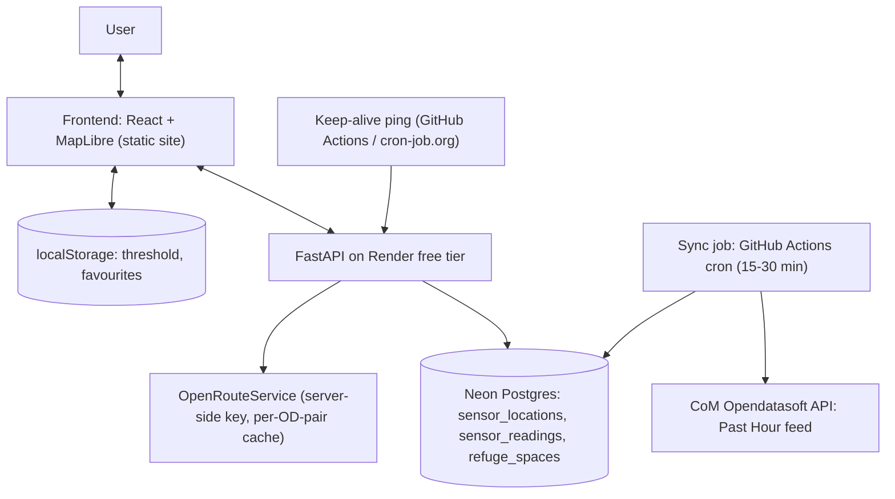

# Hush — Build Plan (Iteration 1)

Sensory-aware wayfinding web app for Melbourne CBD. Users plan walking routes scored against live pedestrian sensor data, with a High/Low sensory-load badge per route and a user-adjustable density threshold.

- **Timeline:** 1 week (build, test, deploy), plus a demo/judging period afterward.
- **Budget:** $0 hosting. Free tiers + GitHub Student Developer Pack only.
- **Scope:** Epic 1 — US1.1 (sensory indicator, must-have) and US1.2 (avoid congestion, must-have). US1.3 (peak-hour reroute) deferred.

---

## 1. Stack (locked)

| Component | Choice | Notes |
|---|---|---|
| Frontend | React + Vite | Deployed as a static site (never sleeps) |
| Map | MapLibre GL via `@vis.gl/react-maplibre` | React map components (`<Map>`, `<Source>`, `<Layer>`, `<Marker>`) |
| Map tiles | OpenFreeMap public instance | Free vector tiles, no API key, no registration, no rate limits |
| Backend | Python + FastAPI | Render free tier web service |
| Database | PostgreSQL on **Neon free tier** | Permanent free tier, no expiry, 0.5 GB, auto-wakes <1 s |
| Sync job | **GitHub Actions scheduled workflow** | Every 15–30 min; Render has no free cron |
| Routing | OpenRouteService (public API, free key) | Called server-side only; 2,000 directions/day, 40/min |
| Live data | City of Melbourne Open Data (Opendatasoft Explore API v2.1) | `data.melbourne.vic.gov.au` — not data.gov.au (catalog only) |
| Client prefs | Browser localStorage | Threshold, favourites — no login (AC 1.2.5) |
| Hosting | Render (backend), Render static/Netlify/GitHub Pages (frontend) | Keep-alive ping keeps backend warm; 24/7 fits 750 free hrs/mo |

**Deliberately not used:** Leaflet (raster tiles can't be restyled — MapLibre vector styles let us serve a calm, decluttered basemap), Render free Postgres (expires 30 days after creation), Supabase free (pauses after 7 idle days, manual restore), PostGIS (134 sensors — brute-force haversine in Python is enough), web push notifications (out of scope this iteration).

**Scope note:** this is route *planning and display* (scored routes drawn on a map), not live turn-by-turn GPS navigation.

---

## 2. Architecture

### Data model (minimum)

- `sensor_locations` — sensor_id, name/street, lat, lon, status. Seeded once from the Sensor Locations dataset.
- `sensor_readings` — sensor_id, timestamp, direction, count_per_minute. Upserted by the sync job from the Past Hour feed. Prune rows older than ~24 h to stay well under 0.5 GB.
- `refuge_spaces` — name, lat, lon, type. Seeded once from CoM Open Space data. (Stretch feature.)

### Core flow (one request)

1. Frontend sends origin + destination to `POST /routes`.
2. Backend calls ORS `foot-walking` with `alternative_routes` (target 3; handle 1–2 gracefully).
3. For each route: decode polyline, match sensors within 50 m of each segment (haversine), average matched readings from the latest sync.
4. Return routes sorted by arrival, each with: duration, avg people/min, HIGH/LOW vs user threshold (default 100), worst single sensor + street, no-data segment count. No route hidden (AC 1.1.3).
5. Frontend renders list + MapLibre map with badges, worst-point callout, NO DATA labels, legend.

### Resilience rules

- Sync job failure ≠ demo failure: API serves the latest rows in `sensor_readings` and surfaces data age ("Past Hour feed · 18 min ago" as in the wireframe).
- Ship a canned fallback snapshot (committed fixture) the API can serve if the feed has been dead > N hours.
- ORS responses cached per origin/destination pair (in-memory dict with TTL) to stay far below rate limits and survive brief ORS outages during demo.

---

## 3. Scope

**In (Epic 1):**
- US1.1 Sensory indicator — up to 3 ORS routes; 50 m sensor matching; average score; HIGH/LOW badge vs user threshold; NO DATA segments never assumed calm; worst-point accordion (flag only when > 2x route average and above threshold).
- US1.2 Avoid congestion — search box with current-location default; origin/destination override; map renders US1.1 output (never recomputes); favourites saved to localStorage, no login.

**Stretch:** "Quiet space now" refuge card backed by `refuge_spaces`.

**Out (deferred):** US1.3 peak-hour reroute, Alert Service / push notifications, Threshold Engine as a backend service (threshold is client-side state), Development Activity Monitor / construction layer.

---

## 4. UI design — sensory-first

The wireframes in `context/` are reference material only; the shipped UI follows the principles below, designed for the target user (neurodivergent / sensory-sensitive, per the Freddy persona). The app must never do to the user what the CBD does to them: no noise, no surprises, no pressure.

### Principles

1. **Predictable.** Same layout on every screen, nothing moves or appears unprompted, no layout shift while data loads (reserve space with skeletons, not spinners that reflow).
2. **Low stimulation.** Muted palette, no animation, no flashing, minimal simultaneous information.
3. **User in control.** Nothing auto-dismisses, nothing is hidden from them, every disclosure is user-initiated.
4. **Literal.** Plain, concrete language. No idioms, no exclamation marks, no vague reassurance.
5. **Honest.** NO DATA is labeled as such, data age is always visible, all routes are always shown.

### Visual language

- **Color:** warm off-white background (`#F7F5F0`), soft charcoal text (`#2B2A28` — not pure black on white, to reduce glare). Accents: muted sage green for LOW, muted amber/terracotta for HIGH — never saturated red, which reads as alarm. Badges always pair color with a text label (LOW / HIGH / NO DATA); color is never the only signal. All combinations meet WCAG AA.
- **Typography:** Atkinson Hyperlegible (free Google Font, designed for legibility), system-ui fallback. Body minimum 16 px, line height 1.5–1.6. No long all-caps runs (short badges are fine), no italic body text.
- **Spacing:** generous whitespace, one primary action per screen ("Find calmer routes"), touch targets at least 44 px.
- **Motion:** none by default. No pulsing markers, no route-drawing animations, no auto-panning the map mid-read. Respect `prefers-reduced-motion`; any transition that survives is opacity-only and under 150 ms.

### Interaction rules

- **Progressive disclosure:** route cards show time, arrival, badge, and average by default; the worst-point detail lives in a user-opened accordion (collapsed by default) and stays open until the user closes it.
- **No modals or toasts.** Information appears inline in persistent panels; errors are written in plain language, stay on screen, and state what the user can do ("The pedestrian feed has not updated for 40 minutes. Scores use the last reading from 10:12 am.").
- **Numbers with meaning:** always relate readings to the user's own threshold ("62 people per minute — below your limit of 100"), never raw figures alone.
- **Threshold control:** a slider paired with a numeric input, showing the effect immediately on badges ("Routes above this number are marked HIGH"). Stored in localStorage.
- **Keyboard navigable, visible focus states**; the route list is fully usable without touching the map.

### Map styling (MapLibre)

- Base style derived from OpenFreeMap's `positron` (muted greyscale, low clutter), customized to hide POI icons, transit noise, and advertising-adjacent labels — the map shows streets, the two endpoints, the routes, and nothing else.
- Route lines in the same muted palette (sage for LOW routes, amber for HIGH); the selected route is distinguished by width, not brightness.
- Sensor markers are small static dots; the single worst-point callout is a quiet card, not a bouncing pin.
- No satellite mode, no 3D tilt, no rotation — north stays up.

---

## 5. Build order (day by day)

- **Day 1 — Walking skeleton, deployed.** Repo + CI, hello-world React app and FastAPI service deployed end-to-end (CORS, env vars, auto-deploy on merge to main). Create Neon DB, connect FastAPI. Set up keep-alive ping. *Deployment problems surface today, not day 6.*
- **Day 2 — Data in.** GitHub Actions sync workflow upserting the Past Hour feed into Neon. Seed `sensor_locations` and `refuge_spaces`. Scoring function: ORS polyline decode + 50 m haversine matching + averaging, unit-tested (pytest) against fixture data.
- **Day 3 — Routes API.** `POST /routes` wired: ORS call, scoring, badge/worst-point/no-data logic, OD-pair cache. Test with real demo coordinates (Melbourne Central → Flinders Lane).
- **Day 4 — Route results UI.** Route list with badges, worst-point accordion, no-data chips; MapLibre map with customized positron style, route lines, sensor markers, quiet callout, legend.
- **Day 5 — Trip planner + prefs.** Plan-a-trip form, current-location default, favourites and threshold in localStorage, threshold adjust control.
- **Day 6 — Hardening.** Fallback snapshot path, data-age display, empty/error states, mobile layout pass, pytest green.
- **Day 7 — Buffer + rehearsal.** Full demo rehearsal on the deployed URL (cold, from a phone), fix what breaks, README (setup, env vars, tests).

---

## 6. Risks and mitigations

| # | Risk | Mitigation |
|---|---|---|
| 1 | Render free web service sleeps after 15 min (~1 min wake) | Keep-alive ping every 10 min; static frontend never sleeps |
| 2 | Past Hour feed outage or gaps (sensors only report when count > 0) | Serve latest DB rows + data age; canned fallback snapshot |
| 3 | ORS returns < 3 alternatives for short CBD walks | UI handles 1–2 routes; test demo coordinates on day 3 |
| 4 | GitHub Actions cron fires late under load | Acceptable — feed itself only refreshes every 15 min |
| 5 | Sensor-matching underestimated | Built and unit-tested day 2, before UI work |
| 6 | Neon free tier compute/egress caps (100 CU-hrs, 5 GB/mo) | Tiny workload; prune readings > 24 h old |
| 7 | OpenFreeMap public instance is donation-run (no SLA) | Style URL is one line to swap (Carto basemaps, MapTiler free key); custom style JSON is provider-independent |

---

## 7. Pre-build checklist (verify before day 1)

- [ ] Hit the Past Hour dataset today; confirm it is updating; check `X-RateLimit-*` headers (register a free CoM API key if quota is tight).
- [ ] Get ORS API key; test `foot-walking` + `alternative_routes` on Melbourne Central → Flinders Lane; note how many routes come back.
- [ ] Confirm demo/judging date (drives how long keep-alive + sync must run).
- [ ] Create accounts: Neon, Render, ORS. Optional: Namecheap free domain via Student Pack.

## 8. Conventions (from the code-quality slide)

- GitHub, one feature branch per acceptance criterion, PRs before merge to main.
- ESLint + Prettier (frontend); Black + Ruff (backend); secrets in `.env`, never committed.
- Pytest tests mapped to Gherkin acceptance criteria.
- Four logical modules inside one FastAPI app: route service, threshold logic, refuge locator, (alerts deferred).
- README covers setup, env vars, and test instructions.
