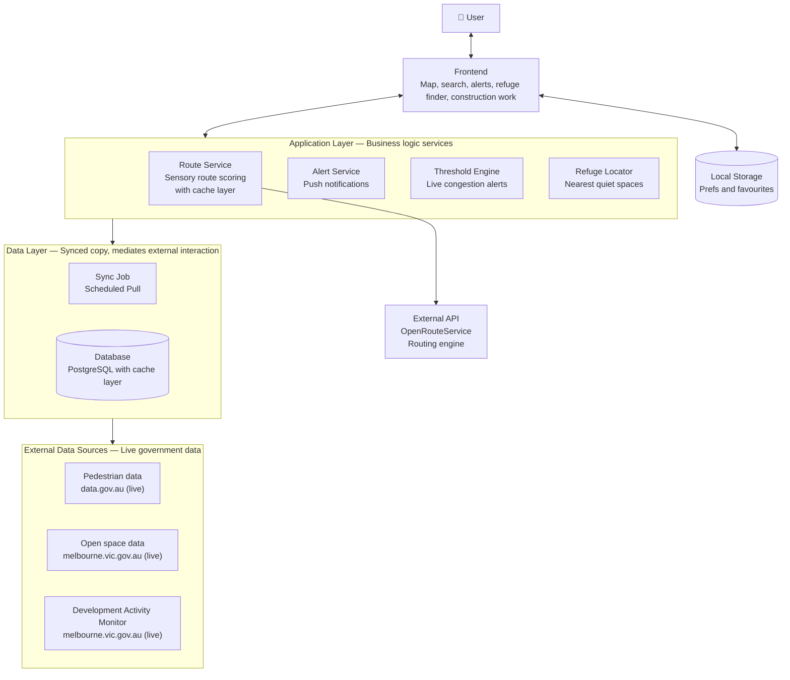

# System Architecture Overview

This document describes a layered architecture for a sensory-friendly navigation application (map, search, alerts, refuge finder, and construction/works tracking).

## Layers

### 1. User

The end user interacts directly with the Frontend layer.

### 2. Frontend

**Responsibilities:** Map, search, alerts, refuge finder, construction work

- Bidirectional connection with the **User** (sends requests, receives UI updates)
- Bidirectional connection with **Local Storage** (reads/writes preferences and favourites)
- Bidirectional connection with the **Application Layer** (requests business logic, receives data)

### 3. Local Storage

- **Purpose:** Stores user preferences and favourites
- Connected directly to the Frontend (client-side, not part of the backend layers)

### 4. Application Layer — Business Logic Services

Contains four core services:

| Service              | Description                               |
| -------------------- | ----------------------------------------- |
| **Route Service**    | Sensory route scoring, with a cache layer |
| **Alert Service**    | Push notifications                        |
| **Threshold Engine** | Live congestion alerts                    |
| **Refuge Locator**   | Finds nearest quiet spaces                |

- Bidirectional connection with the Frontend
- One-way connection down to the **Data Layer** (pulls synced data)

### 5. External API

- **OpenRouteService** — external routing engine used to power route calculations

### 6. Data Layer

**Purpose:** Maintains a synced copy of external data and mediates external interactions

- **Sync Job** — scheduled pull of external data sources
- **Database** — PostgreSQL with a cache layer
- One-way connection down to **External Data Sources**

### 7. External Data Sources — Live Government Data

| Source                           | Origin                      |
| -------------------------------- | --------------------------- |
| **Pedestrian data**              | data.gov.au (live)          |
| **Open space data**              | melbourne.vic.gov.au (live) |
| **Development Activity Monitor** | melbourne.vic.gov.au (live) |

## Data Flow Summary

1. **User** interacts with the **Frontend**.
2. **Frontend** talks to **Local Storage** (client-side prefs/favourites) and to the **Application Layer** (business logic requests).
3. **Application Layer** services (Route Service, Alert Service, Threshold Engine, Refuge Locator) draw on the **Data Layer** for synced data, and the **Route Service** relies on the **External API** (OpenRouteService) for routing calculations.
4. **Data Layer** runs a **Sync Job** on a schedule to pull fresh data into the **Database (PostgreSQL + cache)**.
5. That sync job pulls from **External Data Sources**: live government datasets for pedestrian activity, open space, and development/construction activity.

## Diagram (Mermaid)

